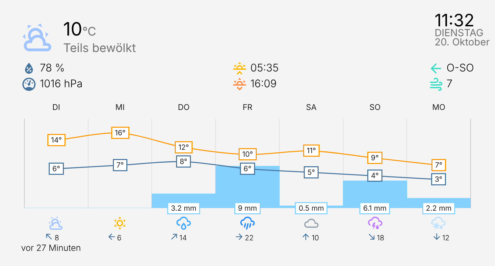
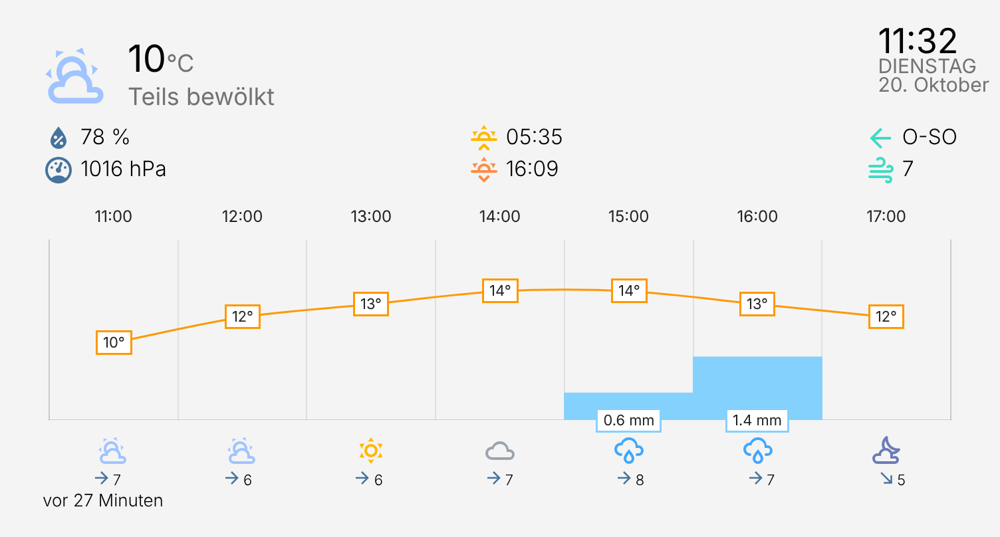

<div align="center">

# 🌤️ Smartify Weather Card

**Wetterkarte mit Temperaturverlauf, farbigen Wetter-Icons und Vorhersage-Diagramm für Home Assistant**

[](https://hacs.xyz)
[](https://www.home-assistant.io)

</div>

Eine angepasste Variante der [weather-chart-card](https://github.com/mlamberts78/weather-chart-card)
von mlamberts78. Sie zeigt das aktuelle Wetter und die Vorhersage als Diagramm an und ist für die
Integration [my-weather](https://github.com/smartify-your-home/my-weather) gedacht. Sie funktioniert
mit jeder `weather.*`-Entity.

## 🖼️ Vorschau

**Tagesvorschau** (`forecast.type: daily`)



**Stundenvorschau** (`forecast.type: hourly`)



*Die Bilder zeigen Beispieldaten.*

## ✨ Features

### Aktuelles Wetter
- 🌡️ Aktuelle Temperatur und Wetterzustand (Text in 23 Sprachen)
- 🎨 **Farbige Wetter-Icons**: Jede Wetterlage hat eine eigene Farbe (Sonne gelb, Regen blau, Gewitter violett, Nebel grau, …), nachts mit eigenem Ton für „teils bewölkt“
- ⚫ **Monochrom-Modus**: Mit `icon_style: monochrome` verwenden alle Icons die Standardfarbe des Themes. Umschaltbar im Editor unter „Icon style“
- 💧 Luftfeuchtigkeit, 🧭 Luftdruck, 💨 Windgeschwindigkeit und Windrichtung
- 🌅 Sonnenaufgang und Sonnenuntergang
- Optional: gefühlte Temperatur, Taupunkt, Windböen, Sichtweite, Wetterbeschreibung
- Optional: „zuletzt aktualisiert vor …“
- 🕐 Optionale Uhrzeit mit Sekunden, Wochentag und Datum, wahlweise im 12-Stunden-Format

### Vorhersage-Diagramm
- 📈 Temperaturverlauf als Liniendiagramm, **täglich** oder **stündlich**
- Zwei Diagrammstile (`style1`, `style2`) mit Tageshöchst- und -tiefstwerten
- ☔ Niederschlag als Balken, wahlweise Menge oder Wahrscheinlichkeit
- Wetter-Icons und Windangaben unter jedem Zeitpunkt
- Einstellbare Anzahl der Vorhersagen, Diagrammhöhe, Schriftgröße und Balkengröße
- Temperaturen auf ganze Zahlen runden, Animation abschaltbar
- Eigene Farben für Temperaturlinien, Niederschlag, Diagrammtext und Datum

### Einheiten und Anpassung
- Luftdruck: `hPa`, `mmHg`, `inHg`
- Windgeschwindigkeit: `km/h`, `m/s`, `Bft`, `mph`
- Einstellbare Größen für Icons, aktuelle Temperatur, Uhrzeit und Datum
- Eigener Pfad für eigene Wetter-Icons
- Automatisches Scrollen der Vorhersage (`autoscroll`)

### Alternative Sensoren
Einzelne Werte lassen sich durch eigene `sensor.*`-Entities ersetzen: Temperatur, gefühlte
Temperatur, Beschreibung, Luftdruck, Luftfeuchtigkeit, UV-Index, Windrichtung, Windgeschwindigkeit,
Taupunkt, Windböen und Sichtweite.

### Sprachen
Bulgarisch, Katalanisch, Tschechisch, Dänisch, Niederländisch, Englisch, Finnisch, Französisch,
Deutsch, Griechisch, Ungarisch, Italienisch, Litauisch, Norwegisch (`nb`), Polnisch, Portugiesisch,
Rumänisch, Russisch, Slowakisch, Spanisch, Schwedisch, Ukrainisch und Koreanisch.
Ohne Angabe wird die Sprache von Home Assistant verwendet.

### Grafischer Editor
Die Karte lässt sich vollständig im Dashboard-Editor einstellen. Sie nutzt dafür native
Bedienelemente und funktioniert damit auch in neueren Home-Assistant-Versionen.

## 📦 Installation

### HACS
1. HACS öffnen, dann Menü oben rechts, dann **Benutzerdefinierte Repositories**.
2. `https://github.com/smartify-your-home/smartify-weather-card` hinzufügen, Typ **Dashboard**.
3. Karte installieren und den Browser-Cache leeren.

> HACS kann nur öffentliche Repositories installieren.

### Manuell
1. `dist/smartify-weather-chart.js` nach `/config/www/` kopieren.
2. Unter **Einstellungen, Dashboards, Ressourcen** `/local/smartify-weather-chart.js` als
   **JavaScript-Modul** hinzufügen.
3. Browser-Cache leeren.

## 🚀 Verwendung

Minimal:

```yaml
type: custom:weather-chart-card
entity: weather.meteonomiqs_wetter
```

Ausführlich:

```yaml
type: custom:weather-chart-card
entity: weather.meteonomiqs_wetter
locale: de
icon_style: colored   # oder monochrome
show_main: true
show_temperature: true
show_current_condition: true
show_attributes: true
show_humidity: true
show_pressure: true
show_wind_direction: true
show_wind_speed: true
show_sun: true
show_feels_like: false
show_dew_point: false
show_wind_gust_speed: false
show_visibility: false
show_last_changed: true
show_time: true
show_time_seconds: false
show_day: true
show_date: true
use_12hour_format: false
autoscroll: false
icons_size: 25
current_temp_size: 28
time_size: 26
day_date_size: 15
units:
  pressure: hPa
  speed: km/h
forecast:
  type: hourly
  style: style1
  number_of_forecasts: 0
  chart_height: 180
  labels_font_size: 11
  precip_bar_size: 100
  precipitation_type: rainfall
  show_probability: false
  condition_icons: true
  show_wind_forecast: true
  round_temp: true
  disable_animation: false
  temperature1_color: rgba(255, 152, 0, 1.0)
  temperature2_color: rgba(68, 115, 158, 1.0)
  precipitation_color: rgba(132, 209, 253, 1.0)
```

## ⚙️ Optionen

| Option | Standard | Beschreibung |
|---|---|---|
| `entity` | – | **Pflicht.** Eine `weather.*`-Entity |
| `title` | – | Titel der Karte |
| `locale` | HA-Sprache | Sprache der Karte, zum Beispiel `de` |
| `icon_style` | `colored` | `colored` (farbige Icons) oder `monochrome` (einfarbig in der Theme-Farbe) |
| `show_main` | `true` | Hauptbereich mit Temperatur und Zustand |
| `show_temperature` | `true` | Aktuelle Temperatur |
| `show_current_condition` | `true` | Wetterzustand als Text |
| `show_attributes` | `true` | Bereich mit Feuchte, Druck, Sonne, Wind |
| `show_humidity` / `show_pressure` | `true` | Luftfeuchtigkeit / Luftdruck |
| `show_wind_direction` / `show_wind_speed` | `true` | Windrichtung / Windgeschwindigkeit |
| `show_sun` | `true` | Sonnenauf- und -untergang |
| `show_feels_like` / `show_dew_point` | `false` | Gefühlte Temperatur / Taupunkt |
| `show_wind_gust_speed` / `show_visibility` | `false` | Windböen / Sichtweite |
| `show_description` | `false` | Wetterbeschreibung |
| `show_last_changed` | `false` | Zeit seit der letzten Änderung |
| `show_time`, `show_time_seconds`, `show_day`, `show_date` | `false` | Uhrzeit, Sekunden, Wochentag, Datum |
| `use_12hour_format` | `false` | 12-Stunden-Format |
| `autoscroll` | `false` | Vorhersage automatisch scrollen |
| `icons_size` | `25` | Größe der Icons |
| `current_temp_size` | `28` | Schriftgröße der aktuellen Temperatur |
| `time_size` / `day_date_size` | `26` / `15` | Schriftgröße Uhrzeit / Tag und Datum |
| `icons` | – | Pfad zu eigenen Wetter-Icons |
| `units.pressure` | `hPa` | `hPa`, `mmHg`, `inHg` |
| `units.speed` | Einheit der Entity | `km/h`, `m/s`, `Bft`, `mph` |
| `forecast.type` | `daily` | `daily` oder `hourly` |
| `forecast.style` | `style1` | `style1` oder `style2` |
| `forecast.number_of_forecasts` | `0` | Anzahl der Einträge, `0` passt sich der Breite an |
| `forecast.chart_height` | `180` | Höhe des Diagramms in Pixeln |
| `forecast.labels_font_size` | `11` | Schriftgröße der Beschriftungen |
| `forecast.precip_bar_size` | `100` | Breite der Niederschlagsbalken in Prozent |
| `forecast.precipitation_type` | `rainfall` | Menge (`rainfall`) oder Wahrscheinlichkeit |
| `forecast.show_probability` | `false` | Niederschlagswahrscheinlichkeit anzeigen |
| `forecast.condition_icons` | `true` | Wetter-Icons unter dem Diagramm |
| `forecast.show_wind_forecast` | `true` | Wind in der Vorhersage |
| `forecast.round_temp` | `false` | Temperaturen runden |
| `forecast.disable_animation` | `false` | Diagrammanimation abschalten |
| `forecast.temperature1_color` | `rgba(255, 152, 0, 1.0)` | Farbe der Höchsttemperatur |
| `forecast.temperature2_color` | `rgba(68, 115, 158, 1.0)` | Farbe der Tiefsttemperatur |
| `forecast.precipitation_color` | `rgba(132, 209, 253, 1.0)` | Farbe des Niederschlags |
| `forecast.chart_text_color` / `forecast.chart_datetime_color` | – | Farbe von Text und Datum im Diagramm |
| `temp`, `feels_like`, `description`, `press`, `humid`, `uv`, `winddir`, `windspeed`, `dew_point`, `wind_gust_speed`, `visibility` | – | Alternative `sensor.*`-Entities |

## 🙏 Credits

Basiert auf der [weather-chart-card](https://github.com/mlamberts78/weather-chart-card) von
mlamberts78 und nutzt [Chart.js](https://www.chartjs.org). Die Lizenz des Originalprojekts gilt auch
für diese Variante.
